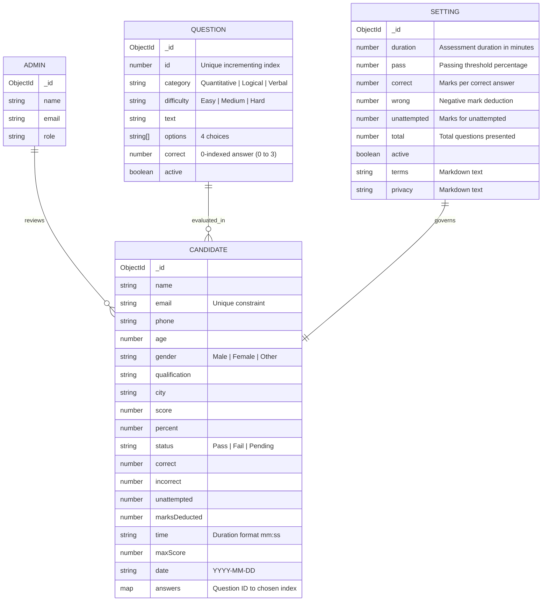

# AptitudePro — Candidate Assessment Platform & Admin Dashboard (Frontend)

AptitudePro is a modern, enterprise-grade online examination and candidate management frontend built with **Next.js 16 (App Router)**, **React 19**, **Tailwind CSS**, and **Redux-Saga**. Inspired by the design standards of Linear and Stripe, it features a unified candidate testing portal and a comprehensive administrative suite.

---

## 🤖 AI Tools Used

The frontend architecture, design system, and micro-interactions were engineered using:
- **Google Antigravity**: Primary agentic AI coding environment for component development, routing architecture, and real-time verification.
- **Claude 3.7 Sonnet & Gemini 2.0 Pro**: Utilized via agent workflows for:
  - Component hierarchy and UI design system (AptitudePro brand orange `#FF6B0A`, neutral stone palette, and responsive typography).
  - Redux Saga asynchronous workflows and live/mock API adapter architecture.
  - Interactive test engine (countdown timer, state recovery, and auto-submit).
  - Accessibility, focus management, and responsive layouts across desktop, tablet, and mobile.

---

## 💬 Key Prompts Used to Build the Application

*(Excluding routine bug fixes; focused on architectural and feature capabilities)*

### 1. Modern SaaS UI/UX Architecture & Theme Foundation
> *"Design a modern, high-conversion candidate assessment platform and admin management portal named AptitudePro. Establish a clean SaaS design system inspired by Linear and Stripe, utilizing AptitudePro brand orange (`#FF6B0A`), crisp typography, subtle borders, and consistent elevation across desktop, tablet, and mobile."*

### 2. Candidate Registration with International Phone Selector
> *"Implement an intuitive candidate registration page capturing candidate name, email, phone number, age, gender, educational qualification, and city. Build a cohesive international phone number input with country flag selection, auto-prefixing, and numeric formatting matching standard input heights."*

### 3. Assessment Instructions & Pre-Flight Checklist
> *"Transform the assessment instructions screen into a world-class examination pre-flight hub. Present modern statistic cards (Total Questions, Duration, Correct Marks, Negative Deduction, Passing Percentage), structured exam guidelines, mandatory declaration acknowledgment, and a secure start button."*

### 4. Interactive Live Assessment Engine & Auto-Submit
> *"Build the live examination interface with a synchronized countdown timer, dynamic question navigation palette (answered, unattempted, marked for review), seamless option selection, and automatic submission upon timer expiration. Include candidate recovery in case of accidental browser refresh."*

### 5. Linear-Style Candidate Management Search & Filter Toolbar
> *"Redesign the Candidate Management toolbar into a unified SaaS toolbar. Place a 340px search input on the left with a live clear button, an adjacent 'Filters' button opening an anchored popover (Assessment Status, Score Range, Attempt Date Range), active filter indicator chips with one-click removal, candidate count, and CSV export aligned to the right."*

### 6. Question Management Toolbar with Category & Difficulty Pills
> *"Refactor the Question Management toolbar to match the modern search and filter layout. Provide an anchored popover with interactive pill selectors for Category (Quantitative, Logical Reasoning, Verbal, Technical), Difficulty Level (Easy, Medium, Hard), and Status (Active, Inactive), with an active question badge and no CSV export."*

### 7. Application Polish: Splash Screen, Page Transitions & Toast System
> *"Implement a branded splash screen for initial application boot, route transition progress indicators, modular skeleton loading states, and a 10x toast notification system supporting success, error, warning, info, and loading states with pause-on-hover."*

---

## 🚀 Setup and Run Instructions

### Prerequisites
- **Node.js**: `v20.19.0` or higher (Node `v22.12+` recommended)
- **Package Manager**: `npm` (v10+)
- **Backend Service**: NestJS backend running on port `5000` (or enable mock mode)

### Installation & Execution

1. Navigate to the frontend directory:
   ```bash
   cd assessment-management-frontend
   ```

2. Install dependencies:
   ```bash
   npm install
   ```

3. Configure environment variables:
   ```bash
   cp env.example .env.local
   ```
   *(Ensure `NEXT_PUBLIC_API_BASE_URL` points to `http://localhost:5000/api`)*

4. Start the development server:
   ```bash
   npm run dev
   ```

5. Open your browser:
   - **Candidate Portal**: [http://localhost:3000](http://localhost:3000)
   - **Candidate Registration**: [http://localhost:3000/register](http://localhost:3000/register)
   - **Assessment Instructions**: [http://localhost:3000/assessment/instructions](http://localhost:3000/assessment/instructions)
   - **Admin Login**: [http://localhost:3000/admin/login](http://localhost:3000/admin/login)
   - **Admin Dashboard**: [http://localhost:3000/admin/dashboard](http://localhost:3000/admin/dashboard)
   - **Candidate Management**: [http://localhost:3000/admin/candidates](http://localhost:3000/admin/candidates)
   - **Question Bank**: [http://localhost:3000/admin/questions](http://localhost:3000/admin/questions)

6. Production Build & Verification:
   ```bash
   npm run build
   ```

---

## 🔐 Environment Variables

Create `.env.local` inside `assessment-management-frontend/`:

| Variable | Default Value | Description |
| :--- | :--- | :--- |
| `NEXT_PUBLIC_API_BASE_URL` | `http://localhost:5000/api` | Base URL pointing to the NestJS backend API |
| `NEXT_PUBLIC_USE_MOCK` | `false` | When set to `true`, enables internal mock adapter for offline demos |
| `PORT` | `3000` | Port for the Next.js development server |

---

## 🔑 Admin Credentials

Default credentials to access the administrative dashboard:

| Field | Value |
| :--- | :--- |
| **Login Route** | `/admin/login` |
| **Email** | `admin@aptitudepro.com` |
| **Password** | `Admin@123` |
| **Role** | `Super Administrator` |

---

## 🗄️ Database Schema (Backend Overview)

The frontend consumes and renders data according to the four primary backend entities:



---

## 💡 Assumptions Made

1. **Scoring Rules & Evaluation**:
   - Each correct response awards `+2` marks (configurable in settings).
   - Each wrong answer incurs a `-1` negative deduction (configurable in settings).
   - Unattempted questions receive `0` marks without penalty.
   - Passing percentage threshold defaults to `60%`.
2. **One Attempt per Candidate**:
   - Candidates are identified by email. Once submitted, duplicate attempts are blocked with a `409 Conflict` notice.
3. **Session Recovery**:
   - Active examination state (current question index, answers, marked-for-review status, timer) is preserved in `sessionStorage` to prevent data loss on accidental browser refreshes.
4. **Offline Demo Fallback**:
   - If the backend is not running, setting `NEXT_PUBLIC_USE_MOCK=true` activates an in-memory & `localStorage` simulation adapter supporting all CRUD actions seamlessly.
5. **Proctoring Guardrails**:
   - Switching browser tabs triggers an on-screen warning toast. Attempting to close the tab triggers a `beforeunload` warning prompt.
6. **URL Query Synchronization**:
   - Filters and search terms on Candidate and Question management pages synchronize directly with URL parameters (`page`, `count`, `search`, `status`, `category`, `difficulty`) to support bookmarking and browser history navigation.
